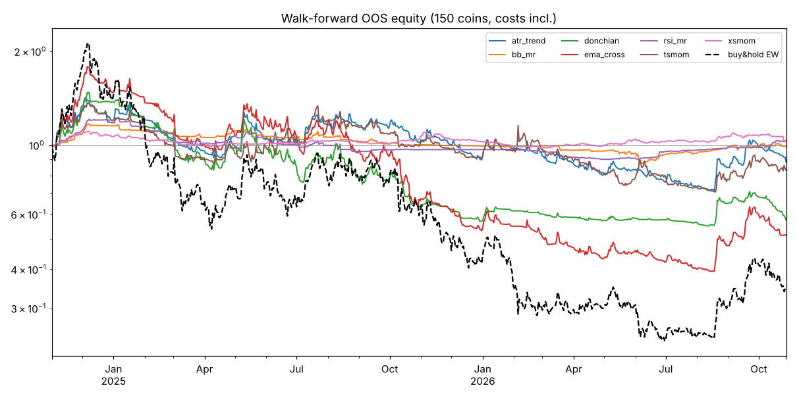

# 전 종목 백테스트 리포트 (2026-11-02)

## 결론 요약

- **실전 배포를 권하는 전략은 없습니다.** 시험한 7개 전략군, 198개 파라미터 조합 중 아웃샘플(OOS), 워크포워드, 비용 2배 스트레스를 모두 통과한 조합은 없었습니다.
- 기존 파이프라인 전략(PCA + RSI/BB + ATR 그리드, LONG 2x)의 자동 판정은 **폐기 (11개 항목 중 3개 통과)** 입니다. 유니버스 52개 심볼의 OOS ROI 중앙값은 -15.4%이고, 수익을 낸 심볼은 21%입니다.
- 상대적으로 가장 나은 것은 **크로스섹션 모멘텀 롱숏(xsmom, 14일, 상·하위 10%)** 입니다. IS 선택 → OOS 결과는 +16.3%, MDD -5.7%, Sharpe 1.72였습니다. 하지만 워크포워드에서는 +3.5%(Sharpe 0.25)에 그쳤습니다. 수수료를 2배로 올리거나 유동성 하한을 높이면 엣지가 사라집니다. 따라서 **페이퍼 트레이딩 후보**로만 둡니다.
- 15분봉 추세추종(EMA 크로스, 돈치안)은 수수료와 휩쏘 때문에 OOS·워크포워드 모두 큰 손실을 냈습니다.

## 1. 데이터와 실행 환경

| 항목 | 내용 |
|---|---|
| 원래 소스 | Bybit v5 API. **샌드박스 네트워크 정책이 차단**해서 사용하지 못했습니다(api.bybit.com, binance, okx 등 모든 거래소 호스트가 프록시 403). |
| 대체 소스 | GitHub 공개 미러 `parshant231234-eng/<SYMBOL>-Historical-Data`. data.binance.vision 의 **Binance 현물** 1분봉을 15분봉으로 집계했습니다(`project/fetch_github_mirror.py`). |
| 유니버스 | 150개 USDT 페어. FTM, WAVES, KLAY, EOS, MKR 등 **상장폐지·중단된 종목도 포함**돼 있어 생존 편향이 일부 줄어듭니다. |
| 기간 | 2023-11-01 ~ 2026-10-28, 15분봉 약 10.5만 개 × 150 |
| 한계 | 현물이라 실제 펀딩비가 없습니다(가정치 0.01%/8h 적용). Bybit 선물과 체결·유동성 차이가 있습니다. 미러에 없는 신규·소형 코인은 빠져 있습니다. |
| 시장 국면 | 동일가중 바이앤홀드 기준 IS 구간 **-7.2%** (MDD -78.7%), OOS 구간(2025-08-17 이후) **-59.9%** (MDD -74.7%). OOS 전체가 알트 약세장입니다. |

## 2. 검증 방법 (과최적화 방지)

| 장치 | 내용 |
|---|---|
| IS/OOS 분리 | 시간 기준 앞 60% = IS(~2025-08-17), 뒤 40% = OOS. **파라미터 순위는 IS로만** 매깁니다. |
| 선택 규칙 | 단일 최고값 대신 **plateau 점수**(해당 조합과 그리드 이웃 조합의 IS Sharpe 평균)를 씁니다. IS 거래가 100건 미만이거나 MDD가 -60%보다 나쁘면 실격입니다. |
| 워크포워드 | 학습 12개월 / 테스트 3개월 롤링, 8개 fold. fold마다 파라미터를 다시 고르고 OOS 구간을 이어 붙였습니다. |
| 비용 | 진입·청산 각각 taker 0.055% + 슬리피지 2bp. 롱은 펀딩 0.01%/8h 부담, 숏은 같은 비율을 수취합니다. 스트레스 런은 수수료 2배 + 슬리피지 4bp입니다. |
| 룩어헤드 | 봉 t 종가에서 신호를 내고, 포지션은 t+1 봉부터 보유합니다. |
| 유동성 | 직전 30일 일거래대금 중앙값이 500만 USDT 이상일 때만 거래합니다(point-in-time). 민감도 런은 2,000만 USDT입니다. |
| 포트폴리오 | 거래 가능한 심볼에 동일가중 1x(무레버리지)로 배분합니다. 롱숏 전략은 심볼당 ±1입니다. |

## 3. 전략군과 그리드

| 전략 | 설명 | 그리드 (조합 수) |
|---|---|---|
| ema_cross | EMA 골든/데드 크로스 | fast 24/48/96, slow 192/384/768, long/롱숏 (18) |
| donchian | N봉 고가 돌파 진입, M봉 저가 이탈 청산 | N 96~960, M 48~288, long/롱숏 (24) |
| tsmom | 시계열 모멘텀 (L일 수익률 > band) | L 3/7/14/30일, band 0/5/10%, long/롱숏 (24) |
| atr_trend | EMA ± k·ATR 켈트너 돌파 | EMA 96/192/384, k 1/2/3, long/롱숏 (18) |
| rsi_mr | RSI 과매도 매수, RSI 회복 시 청산 | n 7/14/28, lo 15~30, hi 50/60/70, 추세필터 on/off (72) |
| bb_mr | 볼린저 하단 이탈 매수, 중심선 청산 | n 20/48/96, k 2/2.5/3, 추세필터 on/off (18) |
| xsmom | 크로스섹션 모멘텀: 매일 L일 수익률 순위 상위(하위) 비율 롱(숏) | L 3/7/14/30일, 비율 10/20/30%, long/롱숏 (24) |

## 4. 결과

### 4.1 IS에서 고른 조합의 OOS 성과 (전략별 1개)

| 전략 | 선택 파라미터 (IS plateau) | IS 수익 | IS Sharpe | **OOS 수익** | **OOS MDD** | **OOS Sharpe** | 승률 | 거래수 | PF | 수익 심볼 비율 |
|---|---|---|---|---|---|---|---|---|---|---|
| ema_cross | fast 96, slow 384, long | +55.2% | 0.76 | -39.4% | -51.9% | -0.99 | 20% | 2,732 | 0.63 | 7% |
| donchian | 480 / 288, long | +15.3% | 0.40 | -32.3% | -48.7% | -0.89 | 26% | 1,224 | 0.59 | 12% |
| tsmom | 14일, band 10%, long | +65.2% | 0.90 | -19.6% | -34.8% | -0.56 | 24% | 789 | 0.61 | 13% |
| atr_trend | EMA 384, 3 ATR, long | +12.1% | 0.36 | -25.1% | -43.4% | -0.56 | 20% | 4,957 | 0.80 | 9% |
| rsi_mr | n 7, <20 → >50, 추세필터 | +27.6% | 1.99 | -7.2% | -9.8% | -1.16 | 57% | 3,564 | 0.83 | 36% |
| bb_mr | n 48, k 3.0, 추세필터 | +32.6% | 2.22 | -3.5% | -6.5% | -0.66 | 57% | 1,208 | 0.86 | 41% |
| **xsmom** | **14일, 상하위 10%, 롱숏** | +8.6% | 0.80 | **+16.3%** | **-5.7%** | **1.72** | 45% | 888 | 1.13 | 45% |
| (벤치) 동일가중 보유 | – | -7.2% | 0.37 | -59.9% | -74.7% | -0.74 | – | – | – | – |

### 4.2 워크포워드 (8 fold, OOS를 이어 붙인 결과, 2024-11 ~ 2026-10)

| 전략 | 수익 | CAGR | MDD | Sharpe | 거래수 | 승률 | 수익 fold |
|---|---|---|---|---|---|---|---|
| ema_cross | -48.6% | -28.4% | -78.2% | -0.46 | 9,522 | 23% | 3/8 |
| donchian | -42.5% | -24.3% | -63.1% | -0.51 | 4,697 | 30% | 2/8 |
| tsmom | -16.9% | -8.9% | -48.7% | -0.03 | 4,739 | 32% | 3/8 |
| atr_trend | -11.8% | -6.1% | -51.7% | 0.03 | 12,047 | 23% | 3/8 |
| rsi_mr | +3.0% | +1.5% | -27.7% | 0.20 | 7,283 | 62% | 3/8 |
| bb_mr | -0.9% | -0.4% | -28.0% | 0.02 | 5,440 | 62% | 2/8 |
| **xsmom** | **+3.5%** | +1.8% | **-12.0%** | **0.25** | 1,585 | 43% | **6/8** |
| 벤치 (같은 기간) | -64.9% | -40.9% | -89.2% | -0.27 | – | – | – |



### 4.3 과최적화 진단 (IS Sharpe와 OOS Sharpe의 순위 상관, 전 조합)

| 전략 | 조합 수 | Spearman | OOS Sharpe 중앙값 | OOS 수익 조합 비율 |
|---|---|---|---|---|
| ema_cross | 18 | -0.02 | -1.00 | 0% |
| donchian | 24 | 0.24 | -0.64 | 8% |
| tsmom | 24 | 0.58 | -0.79 | 0% |
| atr_trend | 18 | 0.89 | -1.49 | 0% |
| rsi_mr | 72 | 0.16 | -0.48 | 25% |
| bb_mr | 18 | 0.23 | -1.01 | 0% |
| xsmom | 24 | -0.10 | -0.07 | 46% |

- 추세 계열(tsmom, atr_trend)은 순위 상관이 높지만 OOS 절대 수준이 모두 음수입니다. 국면이 바뀌면서 전체가 함께 하락한 것입니다.
- xsmom은 순위 상관이 거의 0입니다. OOS에서 이긴 조합을 IS로 미리 알아낼 수 없었다는 뜻입니다. 4.1의 +16.3%에는 운이 상당 부분 섞여 있습니다.

### 4.4 사후 OOS 상위 조합 (참고용, 선택 규칙이 아님)

| 전략 | 파라미터 | IS Sharpe | OOS 수익 | OOS MDD | OOS Sharpe | 거래수 |
|---|---|---|---|---|---|---|
| rsi_mr | n 28, <20 → >50, 필터 없음 | 0.81 | +11.2% | -25.5% | 1.86 | 220 |
| xsmom | 14일, 10%, 롱숏 | 0.80 | +16.3% | -5.7% | 1.72 | 888 |
| xsmom | 3일, 10%, 롱숏 | -1.13 | +14.1% | -9.2% | 1.25 | 1,832 |
| rsi_mr | n 14, <15 → >60, 필터 없음 | 0.96 | +12.2% | -30.9% | 1.16 | 768 |
| rsi_mr | n 28, <15 → >70, 필터 없음 | 0.08 | +36.0% | -8.4% | 1.10 | 60 (PF 50) |

RSI 28 / <15 조합은 거래가 60건밖에 없고 PF가 50입니다. 2025-10 급락 직후 반등 같은 소수 이벤트에 수익이 몰려 있어 재현성을 기대하기 어렵습니다.

### 4.5 견고성 런

| 전략 | 기본 WF | 비용 2배 WF | 유동성 2,000만 WF |
|---|---|---|---|
| xsmom | +3.5% / Sharpe 0.25 / 6/8 fold | -0.7% / 0.00 / 4/8 | -9.8% / -0.30 / 2/8 |
| rsi_mr | +3.0% / 0.20 | -9.3% / -0.11 | +2.5% / 0.16 |
| bb_mr | -0.9% / 0.02 | -9.9% / -0.51 | -6.8% / -0.26 |
| tsmom | -16.9% / -0.03 | -20.8% / -0.10 | -26.5% / -0.23 |

xsmom의 엣지는 비용과 유니버스 구성에 민감합니다. 유동성 하한을 높이면 고베타 소형 알트 숏이 빠지면서 엣지가 사라집니다.

### 4.6 기존 파이프라인 (`python -m src.run_research --universe local`)

- 스캔: 150개 중 52개가 PIT 유동성(1,000만 USDT/일) 기준을 통과했습니다. 바스켓은 ZRO, BNB, ETHFI, LTC, ICP, SOL, TAO, PENDLE입니다.
- 최종 설정: RSI≤40, BB%B≤0.1, ema20>ema50, ADX≥20, 그리드 2ATR×2, TP 1.5ATR, SL -5%, 2x. PCA 필터는 개선 효과가 없어 채택하지 않았습니다.
- 바스켓 OOS: ROI 중앙값 -8.1%, MDD -56%, 수익 심볼 2/8, 승률 약 84%(작은 수익을 자주 내고 큰 손실이 가끔 나는 구조).
- 유니버스 OOS: 52개 심볼, ROI 중앙값 -15.4%, 수익 비율 21%, PF 중앙값 0.81
- 비용 2배: 수익 케이스 0%. Monte Carlo 수익 확률 0%.
- **판정: 폐기 (3/11)**. 전체 리포트는 `backtest_2026-11/research/REPORT_run_research.md` 에 있습니다.

## 5. 추천 설정

실거래 투입 추천은 없습니다. 연구를 이어간다면 우선순위는 아래와 같습니다.

1. **xsmom 롱숏 (lookback 14일, 상·하위 10%, 일 1회 리밸런싱)**: 페이퍼 트레이딩 후보.
   - 수수료가 낮은 체결 방식(메이커, 리밸런싱 밴드)을 적용해 회전율을 줄이는 게 선결 과제입니다.
   - Bybit 선물 실데이터와 실제 펀딩비로 다시 검증해야 합니다.
   - 통과 기준: 워크포워드 Sharpe 0.5 이상, 비용 2배에서도 플러스.
2. **평균회귀 + 추세필터 (bb_mr n48 k3 / rsi_mr n7 <20)**: MDD는 -10% 이하로 낮지만 OOS가 음수입니다. 단독 사용보다는 xsmom과 섞어 분산 효과를 보는 용도로만 검토할 만합니다.
3. **15분봉 추세추종 (ema/donchian/atr_trend)**: 폐기. 굳이 다시 본다면 4시간봉 이상에서만 의미가 있습니다.

## 6. 재현 방법

```bash
cd project
pip install -r requirements.txt
python fetch_github_mirror.py --months 36 --workers 16     # 거래소 API가 막힌 환경
# (API 접근이 가능하면) python fetch_data.py --universe all --days 1095
python -m src.strategy_lab --out results/lab                # 7개 전략 × 198조합, 약 15분
python -m src.strategy_lab --strategies xsmom rsi_mr bb_mr tsmom --fee 0.0011 --slippage-bp 4 --out results/lab_cost2x
python -m src.strategy_lab --strategies xsmom rsi_mr bb_mr tsmom --min-daily-turnover 2e7 --out results/lab_liq20m
python -m src.lab_report --lab results/lab                  # 마크다운 표
python -m src.run_research --universe local --jobs 3        # 기존 파이프라인
```

원자료 CSV는 `docs/backtest_2026-11/` 에 있습니다(`lab/grid_results.csv` = 198조합 전체, `lab/walkforward_folds.csv` = fold별 선택 파라미터).

**주의**: 과거 성과는 미래 수익을 보장하지 않습니다. 이 리포트는 투자 권유가 아닙니다.
